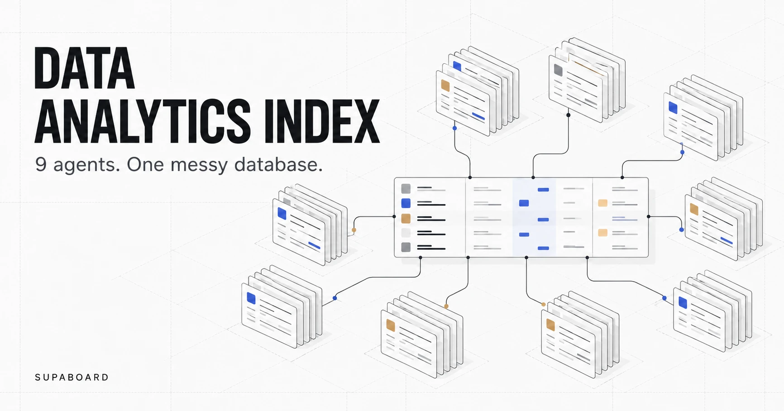
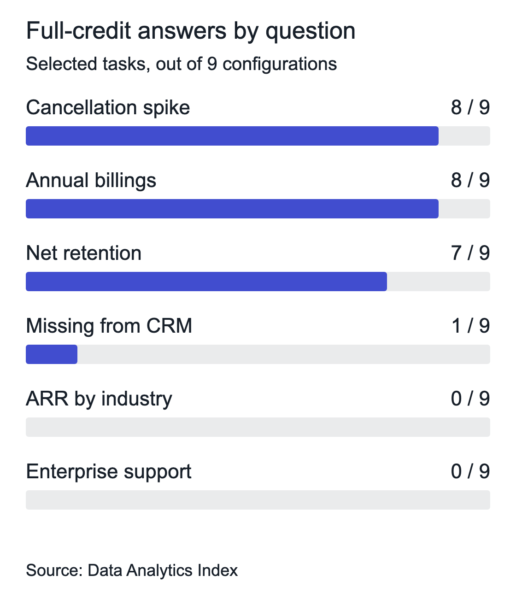

<strong>Disclosure:</strong> We commissioned this benchmark at Supaboard, and we're a participant. Claude designed and ran it for us; a claude configuration is also included in this comparison. These are vendor-reported results from our own repository. We have not published an independent grading audit. (<a href="https://github.com/Supaboard-AI/data-analytics-index/blob/main/README.md#notes">Benchmark notes</a>)

<figure class="hero"></figure>

## The paying customers your CRM cannot see

Which customers are paying us but missing from the CRM?

That's a useful question for an operations team. Someone needs to find those accounts, work out how much revenue they represent, and decide what to fix. An answer that looks plausible can still send the team after the wrong customers.

In the Data Analytics Index, the answer key identified 214 customers representing $59,658.33 in monthly recurring revenue. Supaboard (Stella Pro) matched that result and received full credit. Hex reported 191 customers, Basedash 263, and ChatGPT 305, each with a different revenue total. ([CRM-gap results](https://github.com/Supaboard-AI/data-analytics-index/blob/main/README.md#q8-paying-customers-missing-from-the-crm))

> **What stood out**
>
> - Two targeted Supaboard adjustments reduce its reported score from 35 to 33; a uniform regrade remains unfinished.
> - Customer matching and revenue by industry separated the agents more than several revenue calculations did.
> - The nine configurations have 123 recorded attempts; we use one attempt-selection rule for the regrade.

## What's in the data?

The test business, Corvia Systems, is fictional. It sells scheduling and dispatch software by the seat to clinics and field-service companies. Its Postgres database contains roughly twenty tables across billing, CRM, product usage, support, a legacy billing export and reference data. ([Benchmark setup](https://github.com/Supaboard-AI/data-analytics-index/blob/main/README.md#the-database))

Records are duplicated or inconsistent. Systems do not share clean keys. The agents received no documentation, hints or semantic layer to settle the definitions for them.

Each task began in a fresh chat with the same short company introduction. The thirteen questions covered familiar work: recurring revenue, retention, overdue invoices, sales performance, usage and support. Some recorded exchanges include a clarification telling the agent to use its judgment and state its assumptions. ([Question protocol](https://github.com/Supaboard-AI/data-analytics-index/blob/main/README.md#the-questions), [Supaboard answers](https://github.com/Supaboard-AI/data-analytics-index/blob/main/supaboard-stella-pro/README.md))

This setup tests investigation of unfamiliar data. An evaluation with approved definitions or a curated semantic model would test a different workflow.

## The reported results

This article covers nine configurations from the broader Data Analytics Index; all comparisons and aggregate counts below use those nine. The claude entry uses the report's Sonnet 5.5 results; ChatGPT uses its GPT-6 results. ([claude source record](https://github.com/Supaboard-AI/data-analytics-index/blob/main/claude-sonnet-5-5/README.md), [ChatGPT source record](https://github.com/Supaboard-AI/data-analytics-index/blob/main/chatgpt-gpt-6/README.md))

Supaboard received 35 of 39 available points; claude received 31. These are the original vendor-reported scores reviewed on 21 October 2026, with "accuracy" labeled as the share of available points. Our adjustment and attempt audit follow the table. ([Published scores](https://github.com/Supaboard-AI/data-analytics-index/blob/main/README.md#data-analytics-index-1))

| Agent | Points / 39 | Share of available points |
|---|---:|---:|
| Supaboard (Stella Pro) | 35 | 89.7% |
| claude | 31 | 79.5% |
| Lightdash | 28 | 71.8% |
| Basedash | 27 | 69.2% |
| ChatGPT | 26 | 66.7% |
| Dot | 22 | 56.4% |
| Hex | 19 | 48.7% |
| Sigma | 17 | 43.6% |
| Metabase | 0 | 0.0% |

Metabase's zero reflects the rule requiring the agent to execute its queries: on many tasks, it returned SQL without running it. The transcript separately records results after Claude clicked Run; those evaluator-run results were excluded from Metabase's score. ([Metabase results](https://github.com/Supaboard-AI/data-analytics-index/blob/main/metabase/README.md))

Each response earns up to three points, including partial credit. Divide total points by 39 and multiply by 100 for the normalized percentage; the Data Analytics Index adds ten, so its maximum is 110. Supaboard's reported 35 points give an index of 99.7. ([Scoring formula](https://github.com/Supaboard-AI/data-analytics-index/blob/main/README.md#scoring))

### What changes at 33 points

Two changes alone take Supaboard from 35 to 33 points, or 84.6% of available points and an index of 94.6. This calculation holds every other grade fixed. A replacement leaderboard requires a review of all selected attempts. ([Published totals and formula](https://github.com/Supaboard-AI/data-analytics-index/blob/main/README.md#data-analytics-index-1))

| Supaboard question | Published grade | Targeted adjustment | Reason |
|---|---:|---:|---|
| Q4: recognized revenue | 3 | 2 | Treat $2.6M as a reported number, without a coarse-rounding bonus |
| Q6: receivables | 3 | 2 | The final recommended debtor list includes uncollectible balances |
| Total, all other grades held fixed | 35 | 33 | A limited adjustment, not a full regrade |

For Q4, $2.6M is about 1.2% above the $2,568,266.89 key. Our original precision clause allowed full credit, and even used this answer as its example. Hex's $2,601,203.52, about 1.3% above the same key, earned two points. Removing the coarse-rounding exception is a change to our rubric, and we need to apply it to every agent. ([Revenue results](https://github.com/Supaboard-AI/data-analytics-index/blob/main/README.md#q4-recognized-revenue-q3-2026))

For Q6, Supaboard's first conversation ends with a $649.1K headline and a debtor list containing uncollectible balances, while retaining the exact $305,557.25 open-invoice alternative. Basedash received two points for the same pattern. A final-answer completeness rule would give both two points. Supaboard's earlier response had the open-only list, so the rule must explicitly prevent a superseded answer from supplying the missing credit. ([Supaboard Q6](https://github.com/Supaboard-AI/data-analytics-index/blob/main/supaboard-stella-pro/README.md#q6-overdue-receivables), [Basedash Q6](https://github.com/Supaboard-AI/data-analytics-index/blob/main/basedash/README.md#q6-overdue-receivables))

claude's and Lightdash's customer-count alternatives fall inside the stated five-percent band. A consistent review could change their scores to 32 and 29 respectively, all else fixed. We still need to grade Supaboard's first recorded appointments answer. We will publish a replacement leaderboard only after the same rules have been applied across the selected attempts. ([Customer-count results](https://github.com/Supaboard-AI/data-analytics-index/blob/main/README.md#q13-customer-count))

## Revenue by industry was harder than the cancellation spike

Eight of the nine configurations received full credit for identifying the May cancellation spike as a Meridian Health consolidation involving sixteen clinics on 15 May; eight also received full credit for comparing annual billings. ([Question results](https://github.com/Supaboard-AI/data-analytics-index/blob/main/README.md#which-questions-tripped-agents-up))

The picture changed when the question was annual recurring revenue (ARR) by industry. The key put healthcare at 31.0%. None of these nine configurations received full credit; the reported healthcare shares ranged from Basedash's 14.15% to claude's 47.2%. ([ARR results](https://github.com/Supaboard-AI/data-analytics-index/blob/main/README.md#q9-arr-by-industry))

All the agents that returned a figure in that table named healthcare. A reader checking only the industry label would miss the disagreement over its share of revenue.

*Selected tasks for these nine configurations, recalculated from vendor-reported scores. Full credit follows the benchmark's rounding and alternative-answer rules. ([Published full-credit counts](https://github.com/Supaboard-AI/data-analytics-index#which-questions-tripped-agents-up))*

The practical question is whether the result uses the customer population and revenue definition you intended. A percentage on its own cannot tell you that. You need the underlying records and the agent's assumptions to check it.

## Where Supaboard fell short

Supaboard's original total includes misses. It returned a healthcare share of 29.16% against the 31.0% key and received one point for a reasonable alternative method. ([Supaboard ARR result](https://github.com/Supaboard-AI/data-analytics-index/blob/main/supaboard-stella-pro/README.md#q9-arr-by-industry))

Its published scores also include two points each for the appointments trend and enterprise support questions. ([Supaboard scores](https://github.com/Supaboard-AI/data-analytics-index/blob/main/supaboard-stella-pro/README.md#scores)) 

For seat utilization, Supaboard's headline was "0.57". Its full-credit figure of about 57.52% comes from the uncapped active-customer row dated 15 September in a sensitivity table. Our original rubric allowed matching alternatives, so that credit is retained in the limited 33-point adjustment; it does not establish an exact match for Supaboard's month-end headline. Before accepting that mid-month row in the regrade, we need to check the snapshot required by the full prompt. ([Supaboard Q10](https://github.com/Supaboard-AI/data-analytics-index/blob/main/supaboard-stella-pro/README.md#q10-seat-utilization), [seat-utilization results](https://github.com/Supaboard-AI/data-analytics-index/blob/main/README.md#q10-seat-utilization))

## Speed needs a careful comparison

Basedash had the fastest reported average at 68 seconds. claude averaged 98 seconds and Supaboard 192 seconds. ([Response times](https://github.com/Supaboard-AI/data-analytics-index/blob/main/README.md#average-time-to-answer))

These averages belong to the original mixed-attempt selection. Some recorded timers come from reruns, including Supaboard Q6 and Sigma Q7. We need timings tied to the selected conversations before publishing revised speed comparisons. ([Supaboard Q6](https://github.com/Supaboard-AI/data-analytics-index/blob/main/supaboard-stella-pro/README.md#q6-overdue-receivables), [Sigma Q7](https://github.com/Supaboard-AI/data-analytics-index/blob/main/sigma/README.md#q7-sales-performance-h1-2026))

## Original scoring and limits

The original rubric accepts the key figure as a headline, alternative or sensitivity-table result. Counts must match for full credit; money and rates can fall within 0.1% or match at the written precision. Close answers within five percent earn two points. ([Scoring rules](https://github.com/Supaboard-AI/data-analytics-index/blob/main/README.md#scoring))

This is one synthetic SaaS database. Full prompts, the answer key and the database are available to reviewers on request. claude and ChatGPT used Neon project-owner access; the other agents used a shared read-only role. We report no database writes; we have not measured repeated-run variability. ([Protocol and access notes](https://github.com/Supaboard-AI/data-analytics-index/blob/main/README.md#notes))

## One attempt-selection rule for every agent

For the regrade, we select the first completed recorded conversation for each question. Standardized clarification turns stay within that attempt. The final response and its supporting tables determine the score; an explicitly superseded earlier recommendation cannot rescue the final answer. A completed interaction that returns unexecuted SQL still counts as an attempt. Later attempts stay visible but cannot replace the selected one because they score better.

For these nine configurations, the published records contain 123 attempts across 117 agent-question pairs: six pairs have two attempts. These counts describe the published record, not a complete platform event log. ([Full answer records](https://github.com/Supaboard-AI/data-analytics-index/blob/main/README.md#notes))

| Agent | Recorded attempts | Questions with a second attempt |
|---|---:|---|
| Supaboard (Stella Pro) | 16 | Q6, Q11, Q13 |
| claude | 13 | None recorded |
| Lightdash | 14 | Q10 |
| Basedash | 13 | None recorded |
| ChatGPT | 13 | None recorded |
| Dot | 14 | Q1 |
| Hex | 13 | None recorded |
| Sigma | 14 | Q7 |
| Metabase | 13 | None recorded |

Supaboard has second attempts on Q6, Q11 and Q13. Under this rule, its first conversations are selected in all three cases, including Q13's 863-customer answer. Dot Q1, Lightdash Q10 and Sigma Q7 also select their first conversations. ([Supaboard records](https://github.com/Supaboard-AI/data-analytics-index/blob/main/supaboard-stella-pro/README.md), [Dot records](https://github.com/Supaboard-AI/data-analytics-index/blob/main/dot/README.md), [Lightdash records](https://github.com/Supaboard-AI/data-analytics-index/blob/main/lightdash/README.md), [Sigma records](https://github.com/Supaboard-AI/data-analytics-index/blob/main/sigma/README.md))

We cannot carry Supaboard's Q11 grade across automatically. Its first conversation states 80,467 human appointments and separately 10,459 Zapier appointments for September; the credited 142,668 total is explicit in the rerun. The first conversation references a chart whose full payload is absent from the README. We need that payload or a database check before assigning its replacement grade. We must also match timings to the selected attempts before publishing revised speed averages. ([Supaboard Q11](https://github.com/Supaboard-AI/data-analytics-index/blob/main/supaboard-stella-pro/README.md#q11-appointments-trend))

## The work after the answer

The benchmark measures answers to business questions. It did not score building dashboards, preparing a weekly deck or sending the recurring report. Similar answer scores leave those parts of the product decision open.

Supaboard is the one AI agent that does the whole analyst job on your own database. After an answer, the same agent can build a dashboard, prepare a report or deck, and run the recurring analysis on a schedule. ([Dashboards](https://supaboard.ai/product/dashboards), [Automations](https://supaboard.ai/product/automations))

Give it seven days with one weekly review you already run. Bring twenty questions whose answers you know, teach the agent your definitions, and score its answers with [evaluations](https://supaboard.ai/product/agents). Then check whether it can produce and deliver the review you need. That tests both the answers and the work that follows them.

[Start Free](https://auth.supaboard.ai/onboard/register), or [book a 30-minute demo](https://calendly.com/aritra-ewq/supaboard-demo) to scope that evaluation. Seven days is the suggested evaluation window; access and AI allowances follow the [current plan](https://supaboard.ai/pricing).
