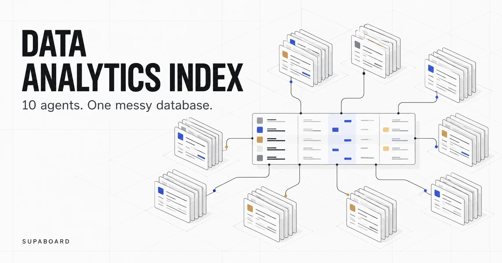
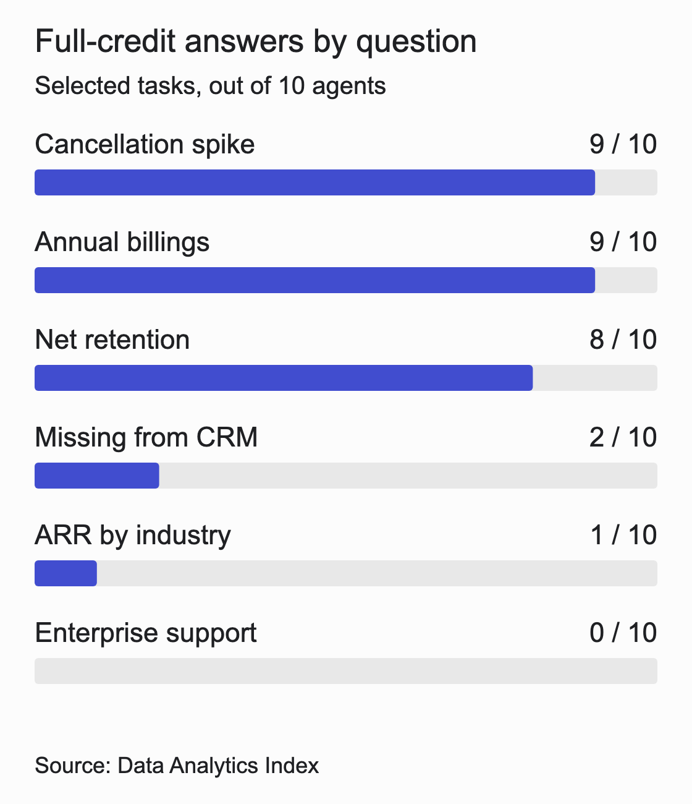

<strong>Disclosure:</strong> We commissioned this benchmark at Supaboard, and we're a participant. Claude designed and ran it for us; its Opus and Sonnet models are participants too. These are vendor-reported results from our own repository. We have not published an independent grading audit. (<a href="https://github.com/Supaboard-AI/data-analytics-index/blob/main/README.md#notes">Benchmark notes</a>)

<figure class="hero"></figure>

<!-- section:content-1 -->

## The same customers, different answers

The Data Analytics Index compares AI data agents on one messy SaaS database. Its most useful finding is the disagreement over customer identity: which records belong to the same business, which accounts count as paying, and how much revenue they represent. ([Benchmark report](https://github.com/Supaboard-AI/data-analytics-index/blob/main/README.md))

Which paying customers are missing from the CRM?

An operations team could use the answer to check account coverage, assign owners or repair incomplete records. Before anyone acts, the agent has to match records across billing and CRM.

The answer key identifies 214 customers representing $59,658.33 in monthly recurring revenue. Supaboard (Stella Pro) and Claude Opus 5.5 received full credit. Hex reported 191 customers, Basedash 263, and ChatGPT 305. An account-repair task would begin with a different work list depending on which answer the team accepted. ([CRM-gap results](https://github.com/Supaboard-AI/data-analytics-index/blob/main/README.md#q8-paying-customers-missing-from-the-crm))

> **What stood out**
>
> - Customer matching and revenue segmentation exposed larger gaps than several headline metrics.
> - Our original table reports a tie, but two targeted Supaboard adjustments reduce its score to 33; a uniform regrade remains unfinished.
> - We found 136 recorded attempts and have documented one selection rule for the regrade.

Jump to [results](#results), [test setup](#setup), [question difficulty](#difficulty), or [scoring and attempts](#scoring).

<!-- section:content-2 -->

## The reported leaderboard

These are our original vendor-reported scores, reviewed on 21 October 2026. We are not treating the shared-first result as settled. The adjustment and attempt audit below explain why a replacement leaderboard needs a broader regrade.

Supaboard and Claude Opus 5.5 each earned 35 of 39 available points, followed by Claude Sonnet 5.5 with 31 points. ([Reported leaderboard](https://github.com/Supaboard-AI/data-analytics-index/blob/main/README.md#data-analytics-index-1)) The table includes every tested configuration.

| Rank | Agent or tested configuration | Points / 39 | Normalized score | Data Analytics Index | Mean time |
|---|---|---:|---:|---:|---:|
| 1= | Claude Opus 5.5 | 35 | 89.7% | 99.7 | 149 s |
| 1= | Supaboard (Stella Pro) | 35 | 89.7% | 99.7 | 192 s |
| 3 | Claude Sonnet 5.5 | 31 | 79.5% | 89.5 | 98 s |
| 4 | Lightdash | 28 | 71.8% | 81.8 | 173 s |
| 5 | Basedash | 27 | 69.2% | 79.2 | 68 s |
| 6 | ChatGPT (GPT-6) | 26 | 66.7% | 76.7 | 196 s |
| 7 | Dot | 22 | 56.4% | 66.4 | 152 s |
| 8 | Hex | 19 | 48.7% | 58.7 | 75 s |
| 9 | Sigma | 17 | 43.6% | 53.6 | 225 s |
| 10 | Metabase | 0 | 0.0% | 10.0 | 180 s |

Metabase's zero reflects the rule requiring the agent to execute its queries: on many tasks, it returned SQL without running it. The transcript separately records results after Claude clicked Run; those evaluator-run results were excluded from Metabase's score. ([Metabase results](https://github.com/Supaboard-AI/data-analytics-index/blob/main/metabase/README.md))

All values in this table are vendor-reported, including the timing figures. The normalized score is the share of rubric points, including partial credit. ([Reported scores](https://github.com/Supaboard-AI/data-analytics-index/blob/main/README.md#data-analytics-index-1), [response times](https://github.com/Supaboard-AI/data-analytics-index/blob/main/README.md#average-time-to-answer))

### What changes at 33 points

Two changes alone take Supaboard from 35 to 33 points, or 84.6% of available points and an index of 94.6. That is below Opus's published 35 and above the other published totals. This calculation holds every other grade fixed. A replacement leaderboard requires a review of all selected attempts. ([Published totals and formula](https://github.com/Supaboard-AI/data-analytics-index/blob/main/README.md#data-analytics-index-1))

| Supaboard question | Published grade | Targeted adjustment | Reason |
|---|---:|---:|---|
| Q4: recognized revenue | 3 | 2 | Treat $2.6M as a reported number, without a coarse-rounding bonus |
| Q6: receivables | 3 | 2 | The final recommended debtor list includes uncollectible balances |
| Total, all other grades held fixed | 35 | 33 | A limited adjustment, not a full regrade |

For Q4, $2.6M is about 1.2% above the $2,568,266.89 key. Our original precision clause allowed full credit, and even used this answer as its example. Hex's $2,601,203.52, about 1.3% above the same key, earned two points. Removing the coarse-rounding exception is a change to our rubric, and we need to apply it to every agent. ([Revenue results](https://github.com/Supaboard-AI/data-analytics-index/blob/main/README.md#q4-recognized-revenue-q3-2026))

For Q6, Supaboard's first conversation ends with a $649.1K headline and a debtor list containing uncollectible balances, while retaining the exact $305,557.25 open-invoice alternative. Basedash received two points for the same pattern. A final-answer completeness rule would give both two points. Supaboard's earlier response had the open-only list, so the rule must explicitly prevent a superseded answer from supplying the missing credit. ([Supaboard Q6](https://github.com/Supaboard-AI/data-analytics-index/blob/main/supaboard-stella-pro/README.md#q6-overdue-receivables), [Basedash Q6](https://github.com/Supaboard-AI/data-analytics-index/blob/main/basedash/README.md#q6-overdue-receivables))

Opus's support answer includes a replied-only median of about 101 minutes that appears eligible for two points under the alternative-answer rule, versus its published one. Sonnet's and Lightdash's customer-count alternatives also fall inside the stated five-percent band. A consistent review could therefore change Opus to 36, Sonnet to 32 and Lightdash to 29, all else fixed. We still need to grade Supaboard's first recorded appointments answer. We will publish a replacement leaderboard only after the same rules have been applied across the selected attempts. ([Opus Q12](https://github.com/Supaboard-AI/data-analytics-index/blob/main/claude-opus-5-5/README.md#q12-enterprise-support-responsiveness), [customer-count results](https://github.com/Supaboard-AI/data-analytics-index/blob/main/README.md#q13-customer-count))

<!-- section:content-3 -->

## Which tools were tested, and on what data

We selected tools we could access with our available resources. We could not obtain access to Omni, Snowflake CoWork or Databricks Genie without a sales-led process, so they are absent from this edition. We therefore have no results for those products.

Corvia Systems is a fictional company selling scheduling and dispatch software to clinics and field-service businesses. Its Postgres database contains roughly 20 tables covering billing, CRM, product usage, support, legacy billing and reference data. ([Database description](https://github.com/Supaboard-AI/data-analytics-index/blob/main/README.md#the-database))

The records are deliberately messy. Systems lack clean shared keys, some records are duplicated or inconsistent, and definitions must be inferred from the data. Agents received database access without documentation, hints or a semantic layer. ([Database description](https://github.com/Supaboard-AI/data-analytics-index/blob/main/README.md#the-database))

This tests how an agent investigates unfamiliar data. An evaluation with approved metric definitions and curated models would test a different workflow.

Each agent answered the same 13 questions, with each question in a fresh chat and the same short company introduction. ([Question protocol](https://github.com/Supaboard-AI/data-analytics-index/blob/main/README.md#the-questions)) The questions covered recurring revenue, retention, receivables, sales, customer identity, usage and support. Some exchanges included a clarification instructing the agent to use its judgment and explain its assumptions. ([recorded Supaboard answers](https://github.com/Supaboard-AI/data-analytics-index/blob/main/supaboard-stella-pro/README.md))

Access was not identical. Claude and ChatGPT used Neon connectors with owner access restricted to the benchmark project; the other agents shared a read-only database role. The report says no agent wrote to the database. ([Access notes](https://github.com/Supaboard-AI/data-analytics-index/blob/main/README.md#notes)) 

<!-- section:content-4 -->

## Customer identity was harder than several headline metrics

Annual recurring revenue (ARR) by industry had the lowest average score: 0.60 out of 3, with only Claude Opus receiving full credit. The CRM-gap question averaged 1.00, with full credit for only Opus and Supaboard. ([Question difficulty](https://github.com/Supaboard-AI/data-analytics-index/blob/main/README.md#which-questions-tripped-agents-up))

By comparison, the cancellation-spike and annual-billings questions each earned full credit for 9 of the 10 agents, while net revenue retention earned full credit for 8. ([Question difficulty](https://github.com/Supaboard-AI/data-analytics-index/blob/main/README.md#which-questions-tripped-agents-up)) Success on retention or billings did not guarantee success on customer reconciliation.

<figure>

<figcaption>Selected tasks. Full credit follows the benchmark’s rounding and alternative-answer rules. Vendor-reported. (<a href="https://github.com/Supaboard-AI/data-analytics-index#which-questions-tripped-agents-up">Data Analytics Index</a>)</figcaption>
</figure>

For ARR by industry, the answer key puts Healthcare at 31.0%; the reported answers include 14.15% from Basedash, 29.16% from Supaboard, 36.5% from Lightdash and 47.2% from Claude Sonnet. ([ARR-by-industry results](https://github.com/Supaboard-AI/data-analytics-index/blob/main/README.md#q9-arr-by-industry)) Agreement on the industry label concealed substantial disagreement about its share of revenue. The published comparison does not isolate the cause of each mismatch, so the figures alone cannot tell us which join or definition went wrong.

Even the simple-sounding customer-count question was difficult: Supaboard alone received full credit for the answer-key count of 863 paying customers. ([Customer-count results](https://github.com/Supaboard-AI/data-analytics-index/blob/main/README.md#q13-customer-count)) A buyer evaluating AI data analytics tools should include questions about who counts as a customer, alongside questions about how much revenue those customers generate.

<!-- section:content-5 -->

## Supaboard's strongest answers and its misses

Supaboard matched the CRM-gap answer and received full credit on customer count. Its misses matter just as much when those questions are part of your weekly review. ([CRM-gap results](https://github.com/Supaboard-AI/data-analytics-index/blob/main/README.md#q8-paying-customers-missing-from-the-crm), [customer-count results](https://github.com/Supaboard-AI/data-analytics-index/blob/main/README.md#q13-customer-count))

Its weakest result was ARR by industry: 29.16% against the answer key's 31.0%, earning 1 point for a reasonable, correctly calculated interpretation under the rubric. ([ARR-by-industry results](https://github.com/Supaboard-AI/data-analytics-index/blob/main/README.md#q9-arr-by-industry)) 

For appointments, the original score table used Supaboard's rerun figure of 142,668 against the September all-appointments key of 139,943 and awarded 2 points. ([Appointments results](https://github.com/Supaboard-AI/data-analytics-index/blob/main/README.md#q11-appointments-trend)) It also received 2 points for enterprise support responsiveness, a question on which no agent received full credit. ([Support results](https://github.com/Supaboard-AI/data-analytics-index/blob/main/README.md#q12-enterprise-support-responsiveness))

For seat utilization, Supaboard's headline was "0.57". Its full-credit figure, about 57.52%, comes from the uncapped active-customer row dated 15 September in a sensitivity table. Opus's 57.4% headline earned two points. Our original rubric allowed matching alternatives, so that credit is retained in the limited 33-point adjustment; it does not show that Supaboard's month-end headline was more accurate. A regrade that requires a particular snapshot must check the full prompt before accepting the mid-month row. ([Supaboard Q10](https://github.com/Supaboard-AI/data-analytics-index/blob/main/supaboard-stella-pro/README.md#q10-seat-utilization), [seat-utilization results](https://github.com/Supaboard-AI/data-analytics-index/blob/main/README.md#q10-seat-utilization))

<!-- section:content-6 -->

## Faster answers did not settle the comparison

Basedash had the shortest reported mean response time at 68 seconds, compared with 149 seconds for Claude Opus and 192 seconds for Supaboard. ([Response-time results](https://github.com/Supaboard-AI/data-analytics-index/blob/main/README.md#average-time-to-answer)) Basedash also received full credit on retention, the cancellation spike, recognized revenue, annual billings and sales performance. ([Question-level results](https://github.com/Supaboard-AI/data-analytics-index/blob/main/README.md#results-by-question)) Its speed deserves consideration alongside its misses on customer reconciliation and industry ARR.

Those averages belong to the original mixed-attempt selection. Supaboard Q6's timer is from its rerun, and Sigma Q7's 55 seconds is also explicitly a rerun timer. We will recalculate speed comparisons from the selected first conversations instead of carrying those averages into a regraded table. Platform timers and SQL-approval waits still need consistent treatment. ([Supaboard Q6](https://github.com/Supaboard-AI/data-analytics-index/blob/main/supaboard-stella-pro/README.md#q6-overdue-receivables), [Sigma Q7](https://github.com/Supaboard-AI/data-analytics-index/blob/main/sigma/README.md#q7-sales-performance-h1-2026), [timing method](https://github.com/Supaboard-AI/data-analytics-index/blob/main/README.md#average-time-to-answer))

<!-- section:content-7 -->

## How the original scoring works

Each answer earns up to three points: three when the key figure appears, including in an alternative or sensitivity table; two for a figure within five percent; one for a reasonable stated method with a result checked against the database; and zero otherwise. Counts must match for full credit. Money and rates can be within 0.1% or match at the precision used in the answer. ([Scoring and precision rules](https://github.com/Supaboard-AI/data-analytics-index/blob/main/README.md#scoring))

The maximum is 39 points. Divide the total by 39 and multiply by 100 for the normalized score, then add ten for the Data Analytics Index, whose maximum is 110. A score of 89.7% therefore means 89.7% of available rubric points, not that 89.7% of questions were answered exactly. ([Index calculation](https://github.com/Supaboard-AI/data-analytics-index/blob/main/README.md#scoring))

We publish answer summaries and full agent responses. Full prompts, the database and the answer key are available to reviewers on request; repeated-run variability is not reported. This is a vendor-run evaluation on one synthetic database, with the conflicts of interest disclosed above. ([Protocol and access notes](https://github.com/Supaboard-AI/data-analytics-index/blob/main/README.md#notes))

## One attempt-selection rule for every agent

For the regrade, we select the first completed recorded conversation for each question. Standardized clarification turns stay within that attempt. The final response and its supporting tables determine the score; an explicitly superseded earlier recommendation cannot rescue the final answer. A completed interaction that returns unexecuted SQL still counts as an attempt. Later attempts stay visible but cannot replace the selected one because they score better.

The published records contain 136 attempts across 130 agent-question pairs: six pairs have two attempts. These counts describe the published record, not a complete platform event log. ([Full answer records](https://github.com/Supaboard-AI/data-analytics-index/blob/main/README.md#notes))

| Agent | Recorded attempts | Questions with a second attempt |
|---|---:|---|
| Claude Opus 5.5 | 13 | None recorded |
| Supaboard (Stella Pro) | 16 | Q6, Q11, Q13 |
| Claude Sonnet 5.5 | 13 | None recorded |
| Lightdash | 14 | Q10 |
| Basedash | 13 | None recorded |
| ChatGPT (GPT-6) | 13 | None recorded |
| Dot | 14 | Q1 |
| Hex | 13 | None recorded |
| Sigma | 14 | Q7 |
| Metabase | 13 | None recorded |

Supaboard has second attempts on Q6, Q11 and Q13. Under this rule, its first conversations are selected in all three cases, including Q13's 863-customer answer. Dot Q1, Lightdash Q10 and Sigma Q7 also select their first conversations.  ([Supaboard records](https://github.com/Supaboard-AI/data-analytics-index/blob/main/supaboard-stella-pro/README.md), [Dot records](https://github.com/Supaboard-AI/data-analytics-index/blob/main/dot/README.md), [Lightdash records](https://github.com/Supaboard-AI/data-analytics-index/blob/main/lightdash/README.md), [Sigma records](https://github.com/Supaboard-AI/data-analytics-index/blob/main/sigma/README.md))

We cannot carry Supaboard's Q11 grade across automatically. Its first conversation states 80,467 human appointments and separately 10,459 Zapier appointments for September; the credited 142,668 total is explicit in the rerun. The first conversation references a chart whose full payload is absent from the README. We need that payload or a database check before assigning its replacement grade. We must also match timings to the selected attempts before publishing revised speed averages. ([Supaboard Q11](https://github.com/Supaboard-AI/data-analytics-index/blob/main/supaboard-stella-pro/README.md#q11-appointments-trend))

<!-- section:content-8 -->

## Questions to ask before using the benchmark

### What does this comparison tell us?

It compares answer quality under the reported setup. Building a live dashboard, producing the weekly report and delivering it on schedule are separate jobs. The benchmark did not score those workflows. Evaluate them separately before treating similar answer scores as evidence that two products do the same work. ([Question list](https://github.com/Supaboard-AI/data-analytics-index/blob/main/README.md#the-questions))

### Why compare general-purpose assistants with BI products?

Both can answer business questions from a connected database. The useful comparison is the evidence each returns for the same question. When choosing a product, also test the work around that answer: configuration, collaboration, recurring reporting and the effort required to keep it useful as your data changes.

### Does full credit mean the headline answer matched?

Full credit can come from an alternative answer or a sensitivity table. For a team that reads only the summary, that distinction matters. Check where the matching result appears, which definition the agent recommends, and whether a reader can understand that recommendation without inspecting every table. ([Scoring rules](https://github.com/Supaboard-AI/data-analytics-index/blob/main/README.md#scoring))

### Can I reproduce the results?

We make the full prompts, database and answer key available to reviewers on request. Our public repository contains the recorded responses and scores. For a reproducible regrade, we also need an explicit attempt ledger, complete grading criteria and timings tied to the selected conversations. ([Access notes](https://github.com/Supaboard-AI/data-analytics-index/blob/main/README.md#notes))

### What would make the Metabase result more informative?

A follow-up should first verify that the agent can execute queries in the intended configuration, then rerun the same questions and record the setup. Report that result separately from this run. The existing zero scores the agent's completed answers; the evaluator's later query executions are recorded in the transcript but excluded from the score. ([Metabase responses](https://github.com/Supaboard-AI/data-analytics-index/blob/main/metabase/README.md))

### Should I supply my business definitions?

Use the configuration you intend to rely on. A test with no documentation measures investigation of unfamiliar data. A test with approved definitions measures whether the agent applies your rules consistently. Record the definitions, permissions and accepted answers before running either test, so a later correction does not quietly change the comparison.

<!-- section:content-9 -->

## Test the whole weekly review

Supaboard is the one AI agent that does the whole analyst job on your own database. After an answer, the same agent can build a dashboard, prepare a report or deck, and run the recurring analysis on a schedule. Those capabilities are separate from the answer-quality results above. ([Dashboards](https://supaboard.ai/product/dashboards), [Automations](https://supaboard.ai/product/automations))

Give it seven days with one weekly review you already run. Bring twenty questions whose answers you know, teach the agent your definitions, and score its answers with [evaluations](https://supaboard.ai/product/agents). Then check whether it can produce and deliver the review you need. That tests both the answers and the work that follows them.

[Start Free](https://auth.supaboard.ai/onboard/register), or [book a 30-minute demo](https://calendly.com/aritra-ewq/supaboard-demo) to scope that evaluation. Seven days is the suggested evaluation window; access and AI allowances follow the [current plan](https://supaboard.ai/pricing).
