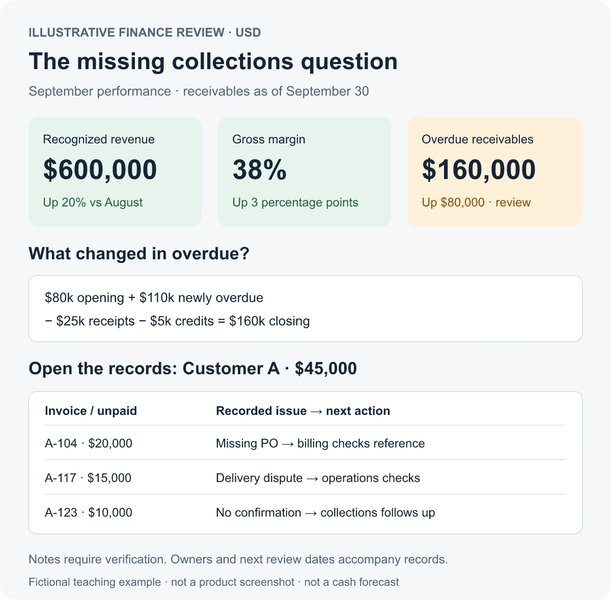

“Sales are up. Margin is up. So why are we chasing payments?”

The finance manager opens the dashboard. Revenue has grown. Gross margin has improved. Every card is green. Across the table, the founder wants to know why collecting enough cash still takes so much work.

**Useful financial dashboard examples connect headline measures to review questions and the records needed to answer them. Revenue and margin show business performance; overdue receivables reveal payments that have missed their due dates. A dashboard needs both views to support a collections discussion.**

Which view is missing from this meeting?

> **Key takeaways**
>
> - Green revenue and margin cards leave payment timing unanswered.
> - Compare overdue balances on a consistent basis, then inspect the invoices and collection notes.
> - Give every headline measure a review question, a comparison and a route to supporting records.

<!-- section:content-1 -->

## The green dashboard leaves one question unanswered

Consider a fictional business selling to customers on credit. Its September dashboard looks encouraging:

| Headline measure | August | September | Card status |
|---|---:|---:|---|
| Recognized revenue | $500,000 | $600,000 | Green: up 20% |
| Gross margin | 35% | 38% | Green: up 3 percentage points |
| Gross profit | $175,000 | $228,000 | Green: up $53,000 |

*All amounts, companies, invoices and dates in this worked example are illustrative. The currency is USD. These are teaching figures, not customer results or industry benchmarks.*

The cards answer valid questions. The business recognized more revenue, and more of that revenue remained after the costs included in gross profit. Gross profit is revenue multiplied by gross margin, so the third card reinforces the first two. It adds no evidence about collections.

The meeting stalls when someone asks, “Which customer payments should already have arrived?” There is no overdue balance, no ageing breakdown and no collection history on the screen.

The green status means these measures improved against August. It says nothing about the question the founder just asked. That is the gap to fix before adding another [business intelligence dashboard](https://supaboard.ai/blog/bi-dashboards).

<!-- section:content-2 -->

## Follow the payment question into receivables

Recognized revenue and cash receipts describe different events. A credit sale can contribute to revenue before the customer pays. Gross margin describes profitability relative to revenue; it does not tell you whether an invoice has been settled. The [SEC’s guide to financial statements](https://www.sec.gov/about/reports-publications/beginners-guide-financial-statements) makes the broader distinction: income statements show profit, while cash flow statements show whether the business generated cash.

For the collections question, start with open receivables. Separate amounts still within agreed payment terms from amounts past their due dates. A large open balance can include perfectly ordinary credit sales; the overdue segment identifies the missed deadlines.

This is why the next view should include ageing and collection records. [ACCA’s guidance on accounts receivable management](https://www.accaglobal.com/sg/en/student/exam-support-resources/fundamentals-exams-study-resources/f9/technical-articles/arm.html) describes aged analysis as a way to see how much each customer owes, how long it has been outstanding and whether credit terms have been breached.

For this example, “overdue” means a positive unpaid invoice balance after its contractual due date. Ageing uses **days past due**, measured at each month-end. An invoice due on the snapshot date is not yet overdue. Applied payments and credit notes reduce the remaining balance.

Both snapshots cover the same business entity and currency, include disputed invoices, and use the same treatment of tax. Missing due dates go into a visible exception list until corrected. They cannot silently count as current.

<!-- section:content-3 -->

## The missing view: what is overdue, and what is blocking it?

The overdue segment changes the conversation:

| Receivables at month-end | August 31 | September 30 | Change |
|---|---:|---:|---:|
| Not yet due | $180,000 | $220,000 | +$40,000 |
| 1–30 days overdue | $50,000 | $70,000 | +$20,000 |
| 31–60 days overdue | $20,000 | $55,000 | +$35,000 |
| More than 60 days overdue | $10,000 | $35,000 | +$25,000 |
| **Total overdue** | **$80,000** | **$160,000** | **+$80,000** |
| **Total open receivables** | **$260,000** | **$380,000** | **+$120,000** |

*Illustrative snapshots. Total overdue is a subtotal of the three overdue bands, not an additional balance.*

Overdue receivables have doubled while the performance cards improved. Now the review has a specific question: **Which invoices account for the deterioration, and what must happen next on each one?**

Start with the $80,000 increase in total overdue. To explain that movement, compare invoice records across the snapshots. Ageing bands alone cannot do this: an unpaid invoice can move into an older band without adding anything to total overdue.

In the illustrative ledger, invoices carrying $110,000 of unpaid balances became overdue during September. Receipts applied to overdue invoices reduced the balance by $25,000, and credit notes reduced it by another $5,000. There were no other overdue-balance movements:

**$80,000 opening overdue + $110,000 newly overdue − $25,000 receipts − $5,000 credits = $160,000 closing overdue.**

That reconciliation explains the increase. The next step identifies the work.

### Walk the largest new overdue balance into its records

Customer A accounts for $45,000 of the $110,000 newly overdue. Its invoices were open but not yet due on August 31. They are still unpaid on September 30:

| Invoice | Due date | Days overdue | Unpaid balance | Latest collection note |
|---|---|---:|---:|---|
| A-104 | September 8 | 22 | $20,000 | Customer reports missing purchase-order reference |
| A-117 | September 15 | 15 | $15,000 | Customer disputes part of the delivery |
| A-123 | September 22 | 8 | $10,000 | No payment confirmation recorded |

*Fictional records as of September 30. The collection notes are leads to verify, not proof of the underlying cause.*

The finance manager can now assign different actions. Billing checks the purchase-order reference on A-104 and corrects it if needed. Operations checks delivery evidence for A-117 and works with the account owner on the dispute. The collections owner follows up on A-123 and records the response.

Capture the owner, next action, next review date and the timestamp of the note. Keep the invoice amount separate from the unpaid amount, and show any partial receipts or credits. A message saying “we have paid” needs checking against the payment and allocation records.

The review has moved from “chase customers harder” to a short list of distinct problems. It has not established a receipt date. Even a recorded promise to pay remains a promise until payment is received.

This overdue view also does not fully explain why cash is tight. Inventory purchases, payroll, supplier payments, debt repayments and other movements can affect the bank balance. To explain the actual cash change, reconcile recorded inflows and outflows separately. The example here is a collections review, **not a cash forecast**.

<!-- section:content-4 -->

## Rebuild the dashboard around the review

Keep the revenue and margin cards. Add the missing collections question and make the supporting detail reachable from the summary.

*Conceptual review layout, using the fictional figures above. This is not a Supaboard product screenshot or a forecast.*

A finance dashboard becomes easier to review when each measure has a defined job. Use the following worksheet to connect the headline, comparison, decision and evidence:

| Measure | Review question and decision | Comparison | Supporting detail |
|---|---|---|---|
| Recognized revenue | Where did growth come from, and which customers or products need investigation? | Prior comparable period; budget if available | Revenue entries by customer and product; recognition dates; credits |
| Gross margin | Which products or jobs changed profitability, and does pricing or cost need review? | Prior period using the same cost definition | Revenue and cost entries by product or job; discounts; cost allocations |
| Gross profit | Which part of the profit change came from revenue, margin or mix? | Prior period, reconciled to revenue and margin | The same revenue and cost records; a bridge explaining the change |
| Overdue receivables | Which missed payments need follow-up, dispute resolution or escalation? | Prior snapshot; movements in and out of overdue | Invoice IDs, due dates, unpaid amounts, ageing, receipts, credits, collection notes and owners |
| Reconciled cash balance | What changed the cash held, and which recorded movements need explanation? | Opening balance plus actual inflows minus actual outflows | Bank transactions, ledger entries and reconciliation exceptions |
| Operating expense variance | Which costs differ from plan, and does the difference require action? | Actual against budget for the same period and scope | Ledger lines, suppliers, departments, accruals and budget assumptions |

The cash and expense rows are additional dashboard examples for different review questions; this worked case does not supply figures for them. Choose the rows your meeting needs. Our [guide to KPIs](https://supaboard.ai/blog/what-is-a-kpi) can help distinguish a decision-relevant measure from a number that merely looks useful.

For your own worksheet, copy these fields and complete one row per metric:

**Metric → definition and scope → review question → decision → comparison → supporting records → owner → refresh time.**

Test each row by taking a changed number all the way to its records. If the records cannot explain the comparison, the dashboard is still missing part of the review.

### Make filters and freshness visible

Put the reporting period, snapshot date, entity, currency and last refresh where reviewers can see them. September revenue is a flow over the month. September 30 overdue receivables are a balance at a point in time. Label both explicitly.

A revenue date filter must not accidentally limit overdue receivables to invoices issued in September. Older unpaid invoices still belong in the September 30 snapshot. Likewise, if the invoice ledger refreshed this morning but collection notes are from last week, show both timestamps.

Agree status rules in advance. In this example, green means improved against the prior month. It does not mean the business has passed a wider financial health check. The overdue card should surface the deterioration even while the revenue and margin cards stay green.

<!-- section:content-5 -->

## A review agenda you can use

Run the meeting in the order the evidence needs to be read:

1. **Confirm the basis.** Check the period, snapshot date, scope, currency and freshness. Resolve material definition or reconciliation issues before interpreting the figures.
2. **Review performance.** Identify what moved in revenue and margin. Open the customer, product or cost breakdown behind the change.
3. **Review collections.** Compare overdue balances and explain the movement with newly overdue invoices, receipts, credits and other adjustments.
4. **Inspect the priority records.** Select balances using amount, age, dispute status and prior follow-up. Verify the notes and assign a next action to a named owner.
5. **Close the loop.** Record what evidence will show progress at the next review: a corrected invoice, resolved dispute, confirmed response or applied receipt.

The meeting output is an action list with evidence attached. A lower overdue balance needs interpretation too: a credit note or write-off can reduce it without bringing in cash.

<!-- section:content-6 -->

## Put the reviewed example into Supaboard

Once the questions and definitions are settled, implement the view against your own data. Supaboard is the one AI agent that does the whole analyst job on your own database. Its [Dashboards](https://supaboard.ai/product/dashboards) support related filters, follow-up questions, and opening records or drilling through the breakdown behind a metric.

Start by checking that the required invoice, payment, credit and collection information is available through your [data connections](https://supaboard.ai/product/data-connections). Then use the worksheet as the dashboard brief:

> Show monthly recognized revenue and gross margin beside month-end overdue receivables. Compare with the previous month on the same basis. Break overdue balances down by days past due and customer. Let reviewers inspect invoice IDs, due dates, unpaid amounts and available collection notes. Keep older unpaid invoices in the snapshot and show data freshness.

Validate the returned totals against the ledger and walk Customer A’s equivalent in your own data through to its records. If collection notes live elsewhere or lack a reliable invoice link, that evidence still needs to be connected or reviewed separately. A dashboard cannot supply a missing customer response.

<!-- section:content-7 -->

## Return to the green cards with a better question

Revenue is still up. Margin is still up. Now the overdue balance appears beside them, and the review can follow its increase into invoices, collection notes and assigned actions.

The dashboard gives the team a route from a headline number to the evidence needed to act. That is what was missing when every card was green.

**Map each metric on your dashboard to one review question.** Then open the supporting records for one changed number. If you cannot complete that path, you have found the next view to build.
