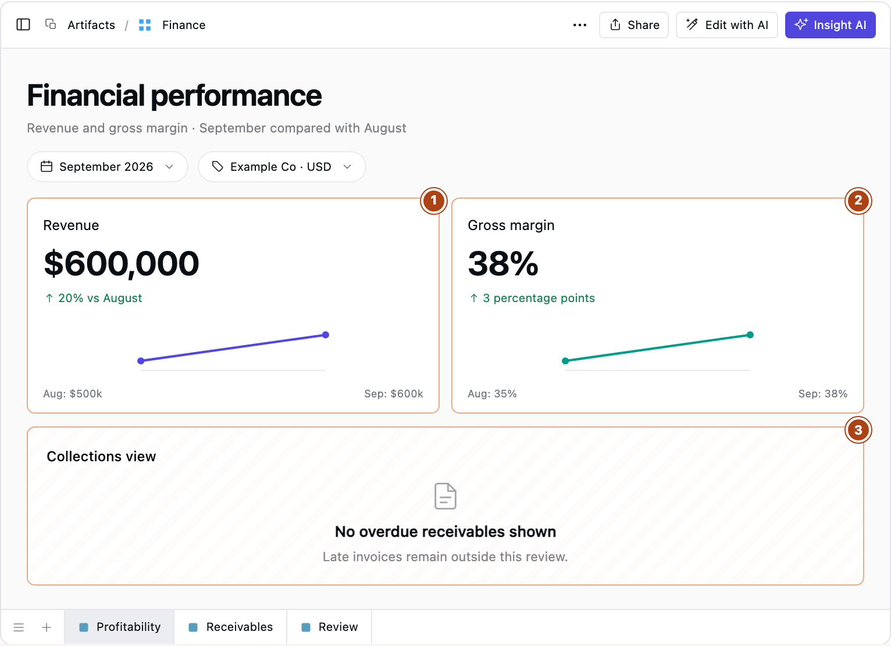
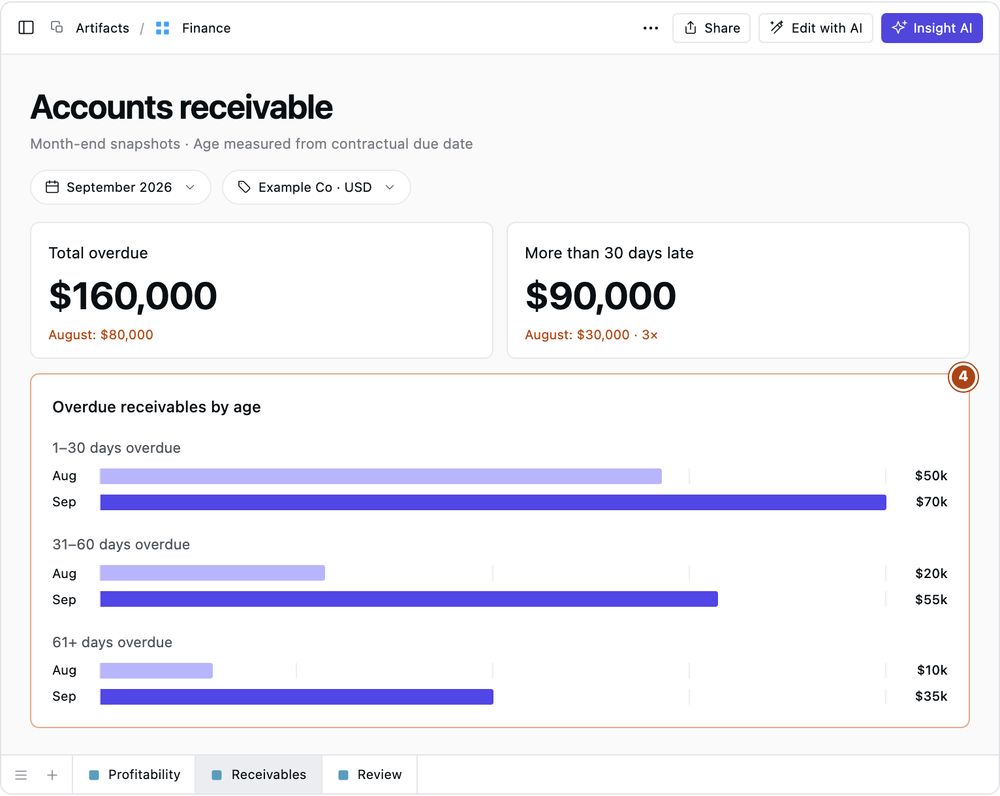
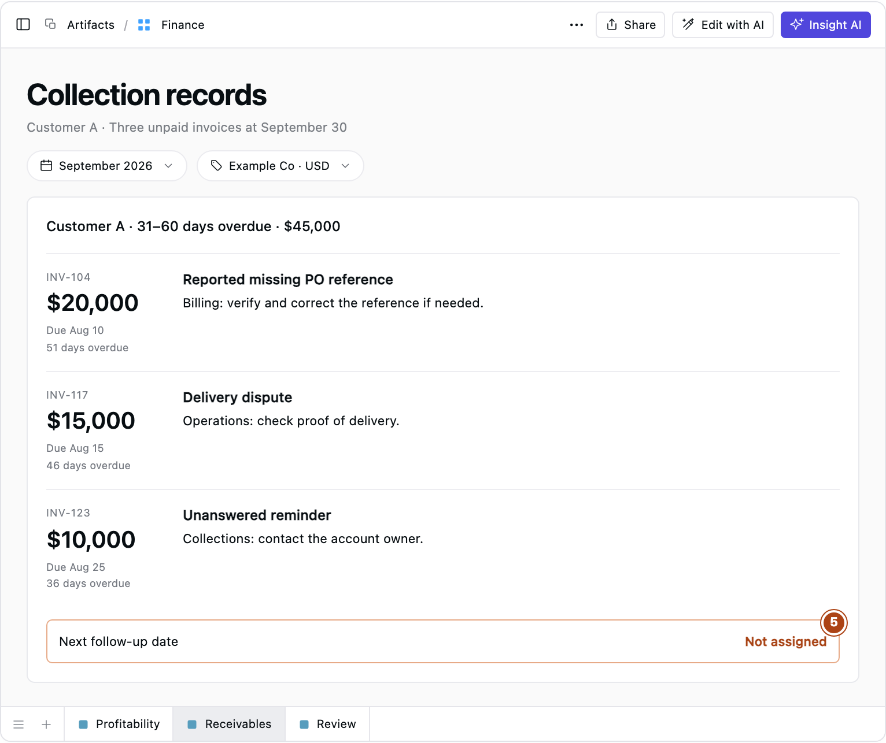

# Financial Dashboard Examples: Why Cash Gets Tight as Sales Grow

Sales are up. Margin is up. So why is the finance team still chasing payments?

A dashboard can report a successful month while leaving collections out of view. Revenue and margin do not tell you whether customers paid.

**A useful financial dashboard connects each measure to a review question, a comparison and the records that explain it.**

These three examples follow one fictional business. The numbered callouts show each view’s limits; all amounts are illustrative USD.

## 1. Profitability dashboard: is sales growth more profitable?

September revenue rose from $500,000 to $600,000; gross margin improved from 35% to 38%. Commercial performance looks stronger.

**1. Revenue is not receipts.** Growth does not show whether customers paid.

**2. Margin is not cash.** Better profitability says nothing about payment timing.

**3. Collections are absent.** Add overdue balances and aging to expose missed payments.

*Illustrative financial dashboard styled after Supaboard. Numbered callouts mark gaps in this example’s configuration.*

The review question is **“Which products or customers improved revenue and margin?”** Product and customer breakdowns distinguish volume growth from price or mix changes. Revenue and cost-of-sales records support pricing decisions.

Under accrual accounting, revenue can be recognized before payment arrives. As the [SEC’s financial statements guide](https://www.sec.gov/about/reports-publications/beginners-guide-financial-statements) explains, profitability and cash generation are different questions.

## 2. Accounts receivable dashboard: which payments need attention?

September’s overdue receivables total $160,000, twice August’s $80,000. An **accounts receivable dashboard** reveals where those unpaid balances sit.

The aging chart exposes a sharper problem: balances more than 30 days overdue have tripled, from $30,000 to $90,000.

**4. Aging locates the problem, not its cause.** Open the customers and invoices behind the older balances.

*Fictional balances. Shared zero baseline and scale; maximum bar value $70k. Invoices not yet due are excluded.*

An **accounts receivable aging report** groups unpaid balances by age—here, days past the contractual due date. [ACCA’s receivables guidance](https://www.accaglobal.com/sg/en/student/exam-support-resources/fundamentals-exams-study-resources/f9/technical-articles/arm.html) explains how this identifies balances that have breached credit terms.

**“Which customers hold the older balances, and what is stopping payment?”** Customer A accounts for $45,000 of the $55,000 in the 31–60-day band. Collection notes suggest three follow-ups:

**5. An action needs a deadline.** Assign a specific owner and follow-up date before closing the review.

*Illustrative records. Customer A accounts for $45,000 of the $55,000 aged 31–60 days.*

Identical reminders would leave the reported reference problem and delivery dispute unresolved. Each needs a different owner.

Link invoices to receipts, credits and dated collection notes so reviewers can verify balance changes. A promise to pay is not a receipt.

Collections explain only part of cash pressure. Payroll, inventory purchases, supplier payments and debt repayments also affect the bank balance.

## 3. Combined dashboard: what needs a decision?

Putting profitability and collections together exposes the trade-off: sales are improving while older invoices remain unpaid. The combined view gives both questions a place in the review.

**6. Overdue balances do not explain all cash movement.** Reconcile bank receipts and payments separately; this view is not a cash forecast.

*The collections gap is visible. A complete cash review still needs actual bank movements. Fictional example.*

Use this worksheet to choose [financial KPIs](https://supaboard.ai/blog/what-is-a-kpi) and the detail that should sit behind them:

| Measure | Review question → decision | Comparison | Supporting detail |
|---|---|---|---|
| Revenue | Where did growth come from? → Adjust sales priorities. | Prior comparable period | Customer and product revenue; recognition entries |
| Gross margin | What changed profitability? → Review pricing or costs. | Prior period, same cost definition | Discounts, product mix and cost-of-sales entries |
| Overdue receivables | What is blocking payment? → Assign collection or dispute work. | Prior snapshot, by age band | Invoices, receipts, credits and collection notes |
| Cash balance | What drove the change? → Review spending and payment timing. | Opening balance plus actual inflows less outflows | Bank transactions and reconciliation |
| Expense variance | Why did spending differ? → Correct, defer or approve costs. | Actual against budget | Ledger entries, suppliers and accruals |

Trace actual bank movements to explain cash changes. Falling overdue balances may reflect credits or write-offs rather than money collected.

Revenue covers a period; receivables describe a snapshot. September receivables must include older unpaid invoices. Show the entity, currency, reporting date and last refresh alongside each view.

The review agenda is straightforward: confirm scope, discuss material changes, inspect supporting records, and assign owners and review dates. Customer A’s dispute becomes an action.

## Take the review into Supaboard

In [Supaboard](https://supaboard.ai/), start with the question the green cards missed: **“Which customers account for balances more than 30 days overdue, and which invoices make up those balances?”**

Connect the invoice and payment records through [data connections](https://supaboard.ai/product/data-connections), then use [Supaboard Dashboards](https://supaboard.ai/product/dashboards) to filter by customer, ask follow-up questions and open the underlying records. Include linked collection notes so reviewers can check whether each delay concerns a billing issue, a dispute or an unanswered reminder.

Revenue and margin can remain green while the review identifies overdue payments and the work needed to resolve them.

**Map each metric on your dashboard to one review question.** Then check that the supporting records can answer it.
