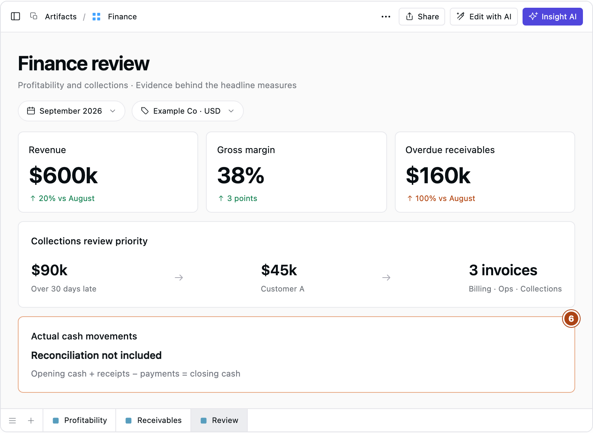

# Financial Dashboard Examples: Why Cash Gets Tight as Sales Grow

Sales are up. Gross margin is improving. The dashboard looks healthy.

So why is the finance team still chasing payments?

The numbers can all be correct. The problem is that revenue and margin answer questions about commercial performance, while the team needs an answer about payment timing.

**A useful financial dashboard connects each measure to a review question, a comparison and the records needed to explain it.**

Here are three connected dashboard examples that show what this looks like in practice. The business and figures are fictional; all amounts are in USD. The numbered callouts highlight gaps in each example’s configuration.

## The first blind spot: growth does not tell you who paid

Consider a business whose revenue rose from $500,000 in August to $600,000 in September. Gross margin improved from 35% to 38%.

Both are encouraging. Neither answers the collections question.

*Illustrative financial dashboard styled after Supaboard.*

**1. Revenue is not receipts.** A higher sales figure does not show whether customers paid.

**2. Margin is not cash.** A more profitable sale can still leave an unpaid invoice.

**3. Collections are absent.** Without overdue balances, the review has no measure of missed payment deadlines.

This dashboard is useful for asking: **“Which products or customers improved revenue and margin?”** Customer and product breakdowns help distinguish volume growth from changes in price or sales mix.

But under accrual accounting, revenue can be recognized before payment arrives. The [SEC’s guide to financial statements](https://www.sec.gov/about/reports-publications/beginners-guide-financial-statements) explains why profitability and cash generation need separate attention.

## The missing view: how old are the unpaid balances?

September’s overdue receivables total $160,000, twice August’s $80,000.

That deserves attention. The aging breakdown reveals something more specific: balances more than 30 days overdue have tripled, from $30,000 to $90,000.

*Fictional month-end balances, grouped by days past the contractual due date. Invoices not yet due are excluded.*

**4. Aging locates the problem, not its cause.** The next step is to inspect the customers and invoices behind the older balances.

An accounts receivable aging report groups unpaid balances by age. As [ACCA’s receivables guidance](https://www.accaglobal.com/sg/en/student/exam-support-resources/fundamentals-exams-study-resources/f9/technical-articles/arm.html) explains, this helps identify balances that have breached credit terms.

The review question becomes: **“Which customers hold the older balances, and what is stopping payment?”**

## Follow one balance into the work needed to resolve it

Customer A accounts for $45,000 of the $55,000 in September’s 31–60-day band. Collection notes point to three different follow-ups:

- **$20,000:** a reported missing purchase-order reference. Billing needs to verify and correct it if necessary.
- **$15,000:** a delivery dispute. Operations needs to check proof of delivery.
- **$10,000:** an unanswered reminder. Collections needs to contact the account owner.

*Illustrative records at September 30. The three invoices total $45,000.*

Sending three identical reminders would leave the reference problem and delivery dispute unresolved. The records explain why different people need to act.

**5. An action needs a deadline.** Assign a specific owner and follow-up date before closing the review.

Link each invoice to receipts, credits and dated collection notes so the team can verify balance changes. A customer’s promise to pay remains a note until payment arrives.

## Bring the questions together without confusing them

A combined dashboard makes the situation clearer: commercial performance improved while older invoices remained unpaid.

Revenue and margin can stay green. The collections problem now has a place beside them.

*The collections gap is visible. A complete cash review still needs actual bank movements.*

**6. Overdue balances do not explain all cash movement.** Payroll, inventory purchases, supplier payments and debt repayments also affect cash. Reconcile actual receipts and payments separately.

This is not a cash forecast. Nor does an $80,000 increase in overdue balances establish an $80,000 cash shortfall.

## Five questions to take into your next finance review

Use these prompts when choosing [financial KPIs](https://supaboard.ai/blog/what-is-a-kpi):

**Revenue: Where did growth come from?** Compare with the previous period, then inspect customer and product revenue and recognition entries before adjusting sales priorities.

**Gross margin: What changed profitability?** Use the same cost definition across periods. Review discounts, product mix and cost-of-sales entries before changing prices or costs.

**Overdue receivables: What is blocking payment?** Compare snapshots by age band. Inspect invoices, receipts, credits and collection notes to assign collection or dispute work.

**Cash balance: What drove the change?** Reconcile opening cash to closing cash using actual receipts and payments. Use bank records to inform spending and payment decisions.

**Expense variance: Why did spending differ from budget?** Inspect ledger entries, suppliers and accruals before correcting, deferring or approving costs.

Check the reporting basis, too. Revenue covers a period; receivables describe a snapshot. A September receivables view must include older unpaid invoices, not just those issued in September.

## Put the review to work in Supaboard

In [Supaboard](https://supaboard.ai/), start with the question the original dashboard missed:

**“Which customers account for balances more than 30 days overdue, and which invoices make up those balances?”**

Bring invoice and payment records into the analysis through [data connections](https://supaboard.ai/product/data-connections). Use [Supaboard Dashboards](https://supaboard.ai/product/dashboards) to filter by customer, ask follow-up questions and open the underlying records. Linked collection notes help reviewers check what is holding up payment.

For the next review, confirm the reporting scope, discuss material changes, inspect the supporting records, and agree owners and review dates.

**Map each metric on your dashboard to one review question.** Then check whether the supporting records can answer it.

Which question does your current financial dashboard still leave unanswered?
